# 💬 Painel de Aprovação WhatsApp + IA

Um painel web simples e didático construído em **Node.js**, **Express** e **Google Gemini AI (`@google/genai`)** para simular o recebimento de mensagens de clientes no WhatsApp, gerar sugestões de respostas automáticas com Inteligência Artificial e permitir que um atendente humano revise, edite e aprove a resposta antes do envio.

> 🎯 **Propósito Didático:** Todo o código deste projeto ([`server.js`](server.js) e [`public/index.html`](public/index.html)) possui **comentários detalhados em todas as linhas**, explicando passo a passo o funcionamento do servidor Express, variáveis de ambiente, Promises (`async/await`), Fetch API e manipulação do DOM.

---

## 📋 Índice

1. [Sobre o Projeto](#-sobre-o-projeto)
2. [Tecnologias Utilizadas](#-tecnologias-utilizadas)
3. [Estrutura de Arquivos](#-estrutura-de-arquivos)
4. [Como Configurar e Rodar](#-como-configurar-e-rodar)
5. [Documentação da API](#-documentação-da-api)
6. [Fluxo de Funcionamento](#-fluxo-de-funcionamento)

---

## 💡 Sobre o Projeto

O sistema simula um painel de atendimento onde a IA atua como assistente do operador humano (**Human-in-the-Loop**):
1. O operador digita uma mensagem simulando a dúvida de um cliente no WhatsApp.
2. Ao clicar em **Gerar Resposta com IA**, o frontend faz uma requisição para o backend Node.js.
3. O backend envia a mensagem para o modelo **`gemini-2.5-flash`**, instruindo-o a responder como um atendente de loja educado e prestativo.
4. A resposta gerada aparece em uma caixa de texto editável (`<textarea>`), permitindo ajustes antes de clicar em **Aprovar e Enviar**.

---

## 🛠 Tecnologias Utilizadas

* **Backend:**
  * **Node.js** — Ambiente de execução JavaScript no servidor.
  * **Express** — Framework web simples e rápido para servir o frontend e criar a rota da API.
  * **@google/genai** — SDK oficial do Google Gemini (usando o modelo `gemini-2.5-flash`).
  * **dotenv** — Carregamento de variáveis de ambiente a partir do arquivo `.env`.
  * **cors** — Liberação de requisições entre origens no navegador.
* **Frontend:**
  * **HTML5 + JavaScript Puro (Fetch API)** — Comunicação assíncrona com o backend e atualização da tela.
  * **Bootstrap 5 (via CDN)** — Estilização limpa e responsiva da interface.

---

## 📂 Estrutura de Arquivos

O projeto segue uma estrutura **simples, direta e enxuta**, ideal para estudos de APIs e Node.js:

```text
WhatsApp-AI-Approval-Panel/
├── public/
│   └── index.html       # Interface do usuário (Bootstrap) + Script Fetch API totalmente comentado
├── .env.example         # Exemplo de arquivo de configuração para a chave da API
├── package.json         # Configurações do projeto Node.js e dependências instaladas
├── server.js            # Servidor Express + Rota de integração com o Gemini (totalmente comentado)
└── README.md            # Documentação do projeto
```

---

## 🚀 Como Configurar e Rodar

### 1. Pré-requisitos
* Ter o [Node.js](https://nodejs.org/) instalado em sua máquina.
* Ter uma chave de API do Google Gemini (crie gratuitamente no [Google AI Studio](https://aistudio.google.com/)).

### 2. Instalar as dependências
No terminal, dentro da pasta do projeto, execute:
```bash
npm install
```

### 3. Configurar o arquivo `.env`
Crie uma cópia do arquivo [`.env.example`](.env.example) na raiz do projeto com o nome **`.env`** e coloque a sua chave real do Gemini:

```env
GEMINI_API_KEY=sua_chave_real_aqui
```

### 4. Iniciar o servidor
Execute o comando abaixo no terminal:
```bash
npm start
```
*(Ou diretamente `node server.js`)*

### 5. Testar no navegador
Abra o navegador e acesse:
👉 **[http://localhost:3000](http://localhost:3000)**

---

## 📡 Documentação da API

### `POST /gerar-resposta`

Recebe a mensagem do cliente no corpo da requisição e devolve a sugestão de resposta gerada pelo Gemini.

* **URL:** `/gerar-resposta`
* **Método:** `POST`
* **Headers:** `Content-Type: application/json`

#### Exemplo de Corpo da Requisição (`Request Body`):
```json
{
  "mensagem": "Olá! Vocês têm tênis de corrida número 40 em estoque?"
}
```

#### Exemplo de Resposta de Sucesso (`200 OK`):
```json
{
  "resposta": "Olá! Tudo bem? 😊 Que alegria atender você! Vou verificar agora mesmo em nosso estoque os modelos disponíveis de tênis de corrida no tamanho 40. Você procura alguma cor ou marca específica?"
}
```

#### Respostas de Erro:
* **`400 Bad Request`** (quando o campo `mensagem` está vazio):
  ```json
  {
    "erro": "A mensagem do cliente é obrigatória."
  }
  ```
* **`500 Internal Server Error`** (quando ocorre erro na chave da API ou na comunicação com o Gemini):
  ```json
  {
    "erro": "Falha ao gerar resposta com a IA. Verifique sua GEMINI_API_KEY no arquivo .env."
  }
  ```

---

## 🔄 Fluxo de Funcionamento

```mermaid
sequenceDiagram
    actor Usuario as Usuário (Navegador)
    participant Frontend as public/index.html
    participant Backend as server.js (Express)
    participant Gemini as Google Gemini API

    Usuario->>Frontend: 1. Digita a mensagem do cliente e clica em "Gerar Resposta com IA"
    Frontend->>Backend: 2. fetch('/gerar-resposta', { method: 'POST', body: JSON })
    Backend->>Gemini: 3. ai.models.generateContent({ model: 'gemini-2.5-flash', contents: prompt })
    Gemini-->>Backend: 4. Retorna a resposta gerada pela IA
    Backend-->>Frontend: 5. res.json({ resposta: respostaGerada })
    Frontend-->>Usuario: 6. Preenche o <textarea> com a sugestão para edição
    Usuario->>Frontend: 7. Clica em "Aprovar e Enviar"
    Frontend-->>Usuario: 8. Exibe alert('Mensagem enviada com sucesso!')
```


